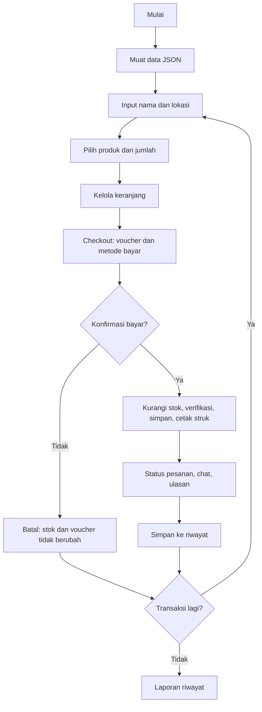

# RuangUMKM: Prototipe Platform Pemesanan Digital untuk UMKM Lokal

> Dari pesanan manual lewat WhatsApp ke alur transaksi digital yang rapi.


RuangUMKM adalah prototipe aplikasi pemesanan untuk UMKM (warung makan, toko kelontong, jajanan rumahan) yang masih menerima pesanan secara manual. Versi ini berupa **modul pembeli berbasis terminal** yang menguji aturan bisnis utama: katalog, keranjang, voucher, pembayaran, struk, dan riwayat transaksi.

<!-- Ganti dengan screenshot atau GIF demo terminal Anda -->
<!--  -->

---

## Latar Belakang

Banyak UMKM menerima pesanan lewat telepon, WhatsApp pribadi, atau datang langsung. Akibatnya:

- pesanan salah catat, lupa dikonfirmasi, atau lupa dikirim;
- stok tidak terpantau;
- sulit menjangkau pelanggan baru tanpa etalase digital;
- platform besar menarik komisi yang memberatkan usaha kecil.

RuangUMKM dirancang sebagai jembatan digital yang sederhana, murah, dan memberi UMKM kontrol penuh atas produk, harga, dan stok.

## Fitur yang Sudah Diimplementasikan (Modul Pembeli)

- **Katalog:** menu ditampilkan langsung, bisa dicari dengan kata kunci (nama, toko, kategori) dan diurutkan berdasarkan nama, harga, stok, atau kategori.
- **Keranjang:** tambah, ubah jumlah, dan hapus barang. Produk yang sama digabung, dan jumlah divalidasi terhadap stok.
- **Voucher:**
  - diskon 10% dari subtotal;
  - diskon tambahan bertingkat (5%, 7,5%, 10%) berdasarkan total belanja;
  - setiap kode maksimal dipakai 5 kali;
  - kode salah atau hangus diberi maksimal 5 kali percobaan;
  - jatah pemakaian baru berkurang setelah pesanan dikonfirmasi, jadi pesanan batal tidak mengurangi jatah.
- **Pembayaran (simulasi):** Tunai (COD), Transfer Bank (7 bank), E-Wallet (5 pilihan), QRIS.
- **Struk:** dicetak di terminal dan disimpan ke `struk/<no_transaksi>.txt`.
- **Status pesanan, chat, dan ulasan:** status `diproses → dikirim → selesai` (simulasi), pesan ke penjual, rating 1–5 per toko.
- **Riwayat transaksi:** dapat diurutkan (tanggal, total bayar, nama pembeli), dicari (no. transaksi, nama, metode, menu), dan diekspor ke `laporan_riwayat.txt`.

## Contoh Perhitungan Voucher

Diskon 10% dihitung dari subtotal. Diskon tambahan ditentukan dari subtotal, tetapi dihitung dari total setelah diskon 10%.

| Total belanja | Diskon voucher 10% | Diskon tambahan | Total bayar |
|---|---|---|---|
| Rp150.000 | Rp15.000 | belum memenuhi syarat | Rp135.000 |
| Rp200.000 | Rp20.000 | 5% = Rp9.000 | Rp171.000 |
| Rp300.000 | Rp30.000 | 7,5% = Rp20.250 | Rp249.750 |
| Rp500.000 | Rp50.000 | 10% = Rp45.000 | Rp405.000 |

## Arsitektur

Kode dipisah menjadi 8 class dengan tanggung jawab jelas:

| Class | Tanggung jawab |
|---|---|
| `Produk` | Data produk dan satu-satunya titik pengurangan stok (`kurangi_stok`) |
| `Katalog` | Koleksi produk, selalu terurut by ID agar binary search valid |
| `ItemKeranjang` | Satu baris di keranjang (referensi produk + qty) |
| `Keranjang` | Mengelola item, subtotal, dan penggabungan produk sama |
| `VoucherManager` | Validasi voucher dan pelacakan pemakaian |
| `Transaksi` | Data transaksi, perhitungan pembayaran, verifikasi, dan pembuatan struk |
| `PenyimpananData` | Seluruh operasi baca/tulis file (JSON dan teks) |
| `AplikasiPembeli` | Orkestrator alur lengkap dari input hingga laporan |



## Highlight Teknis

- **Algoritma manual tanpa library bawaan:** insertion sort yang stabil (`urutkan_data`), binary search berdasarkan ID produk, dan linear search berdasarkan kata kunci.
- **Penyimpanan aman (atomic write):** data ditulis ke file `.tmp` lalu diganti dengan `os.replace()`, sehingga file lama tetap utuh jika program berhenti di tengah penulisan. File JSON yang rusak dipindahkan menjadi `.rusak`.
- **Debugging dan verifikasi:** logging ke `debug.log`, pemeriksaan konsistensi angka transaksi (`Transaksi.verifikasi`) dan stok (`Katalog.verifikasi_stok`), serta penanganan `KeyboardInterrupt` dan error tak terduga di `main()`.
- **Validasi input:** fungsi bantu (`input_angka`, `input_pilihan`, `input_yn`) memastikan input selalu valid.
- **Konfigurasi terpusat:** konstanta (batas voucher, tier diskon, daftar bank) ada di bagian atas file agar mudah diubah.

## Cara Menjalankan

Prasyarat: **Python 3.9 atau lebih baru** (parameter `encoding` pada `logging.basicConfig`). Tidak ada dependensi eksternal.

```bash
git clone https://github.com/<username>/ruang-umkm-buyer-module.git
cd ruang-umkm-buyer-module
python ruang_umkm.py
```

File yang dihasilkan saat program berjalan:

```
data_ruang_umkm.json   # stok, pemakaian voucher, riwayat transaksi
debug.log              # catatan aktivitas dan error
struk/                 # satu file struk per transaksi
laporan_riwayat.txt    # hasil ekspor laporan (jika dipilih)
```

Kode voucher untuk mencoba: `48213976`, `70562184`, `93748215`.

## Dokumentasi

- Proposal proyek mini startup
- Dokumentasi algoritma, flowchart, dan pseudocode
- Slide "Demo dan Bedah Kode Modul Pembeli"

<!-- Tambahkan link ke file di folder docs/ -->

## Batasan Saat Ini

Proyek ini adalah **prototipe**, bukan aplikasi produksi:

- pembayaran, pembaruan status pesanan, dan chat masih **simulasi** (chat hanya mengirim pesan ke penjual, belum dua arah);
- belum ada login atau registrasi;
- modul penjual belum diimplementasikan;
- antarmuka masih terminal.

## Roadmap

- [ ] Antarmuka berbasis web
- [ ] Registrasi dan login (pembeli dan penjual)
- [ ] Modul penjual: kelola produk, konfirmasi pesanan, laporan penjualan
- [ ] Foto dan deskripsi produk, daftar toko terdekat
- [ ] Chat dua arah dan notifikasi
- [ ] Integrasi payment gateway
- [ ] Unit test untuk perhitungan pembayaran dan voucher

## Tim (Kelompok 5, Program Studi Artificial Intelligence)

| Nama | Peran |
|---|---|
| **Aldrin Faza Huda** | Project Leader & Developer |
| Safira Nur Fatihah | Developer |
| Wynne Claudia Chintya Feodora | Developer |
| Raden Heryudoyoko Muhammad Illiyas Aitor | Developer |

## Kontak

Aldrin Faza Huda
[LinkedIn](https://www.linkedin.com/in/aldrin-faza-huda/) · aldrinfazahuda@gmail.com
